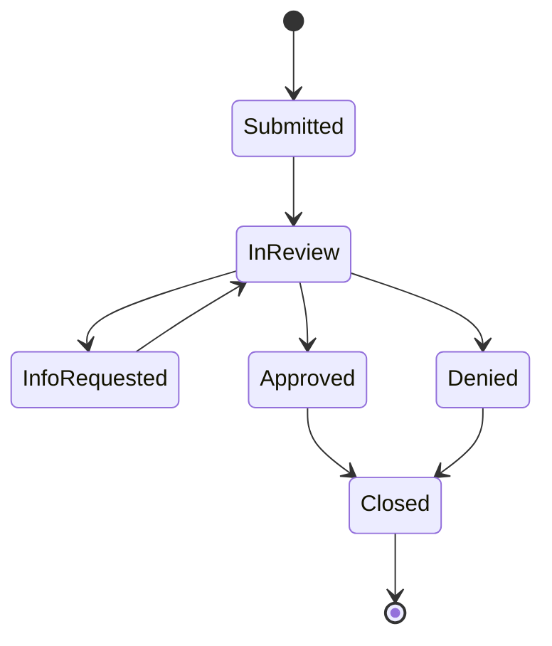

# OneCover Platform

An employee benefits app modeled on group disability and leave workflows, rebuilt as **microservices**.
Members enroll in coverage and file disability leave claims. Admins manage plans, work the claims queue,
and record benefit disbursements.

This is the microservices version of the original OneCover monolith (a layered ASP.NET Core API + Angular app).
Built as a portfolio project in a .NET full-stack training program.

> **Status:** in progress. See [`docs/MICROSERVICES_PLAN.md`](docs/MICROSERVICES_PLAN.md) for the plan and checklist.

## Architecture

```
Angular (web)
     │  one address
  API Gateway (YARP)  ── routes by URL path, rejects bad JWTs
     ├── Identity        users, login/register, JWT, profile       → IdentityDb
     ├── Enrollment      plans, tier rates, eligibility, enrollments → EnrollmentDb
     ├── Claims          claims, workflow, benefit calculator        → ClaimsDb
     └── Disbursements   benefit payouts for approved claims         → DisbursementsDb

Claims ──(ClaimApproved event)──▶ Disbursements
```

| Service | Port |
|---|---|
| Gateway | 5000 |
| Identity | 5001 |
| Enrollment | 5002 |
| Claims | 5003 |
| Disbursements | 5004 |
| Web | 4200 |

- **Database per service.** No service reads another's tables.
- **Shared code is only `contracts/`** (DTOs and event types). No service references another service.
- **Service-to-service calls** go through interfaces (for example `IEnrollmentClient`) over `/internal/**` endpoints that the gateway never exposes.
- **Auth:** Identity issues the JWT. Every service validates it and takes the user id from the token, never the URL or body.

## What's different from the monolith

- **Disbursements only.** Health-insurance premiums are payroll-deducted, so the system stores no premium payments. Members see an estimated per-paycheck deduction instead.
- **Coverage tiers** priced per plan: Employee only, Employee + spouse, Employee + children, Family. The rate is snapshotted on the enrollment, so later rate changes don't alter what a member pays.
- **Events instead of one transaction.** Approving a claim publishes `ClaimApproved`, and Disbursements creates a pending payout.

## Repo layout

```
contracts/OneCover.Contracts      shared DTOs and events
services/identity/                Identity service
services/enrollment/              Enrollment service
services/claims/                  Claims service
services/disbursements/           Disbursements service
gateway/                          YARP gateway
web/                              Angular app
docs/                             plan, endpoint table, architecture notes
```

## Business rules (carried over from the monolith)

**Disability benefit (STD/LTD)**
- Weekly benefit = annual salary ÷ 52 × the plan's benefit percent, capped at the plan's weekly maximum.
  Example: $78,000 ÷ 52 × 60% = **$900/week** (under a $1,500 STD cap).
- Total benefit = (weekly ÷ 7) × payable days. The first *elimination period* days of a leave aren't paid (7 for STD, 90 for LTD).
- Amounts are calculated **only on the server**, once, when the claim is filed. A claim keeps the terms it was filed under even if the plan changes later.

**Claims**
- Claims are disability leaves, so they can only be filed against **active STD or LTD** coverage.
- The leave can't end before it starts or begin before coverage did, and one claim can't cover more than a year.

**FMLA eligibility:** at least 12 months since the hire date **and** at least 1,250 estimated hours in the last 12 months
(full-time = 40 hours a week, part-time = 20).

**Claim workflow.** Every move writes a history row.



**Security**
- Members only see their own data. Someone else's record returns 404, so the API never confirms it exists.
- Only the last 4 digits of the SSN are stored.
- The UI hides what a role can't do, but every service enforces its own rules.

## Tech stack

| Layer | Technology |
|---|---|
| Services | ASP.NET Core Web API (.NET 10), controllers → services → repositories |
| Gateway | YARP reverse proxy |
| Data | EF Core 10 (code-first migrations), SQL Server, one database per service |
| Auth | JWT bearer tokens, role-based authorization (Member / Admin), hashed passwords |
| Front end | Angular, Angular Material, reactive forms |
| Testing | xUnit, Vitest, Postman collection |
| Run | Docker Compose |

## Running locally

_To be filled in as the services and `docker-compose.yml` come online._

## Reference

The original monolith this was derived from is kept as read-only reference, in a sibling folder `../OneCover`.

## Team

Two developers split by service. Ownership and workflow are in [`CLAUDE.md`](CLAUDE.md) and the plan.
