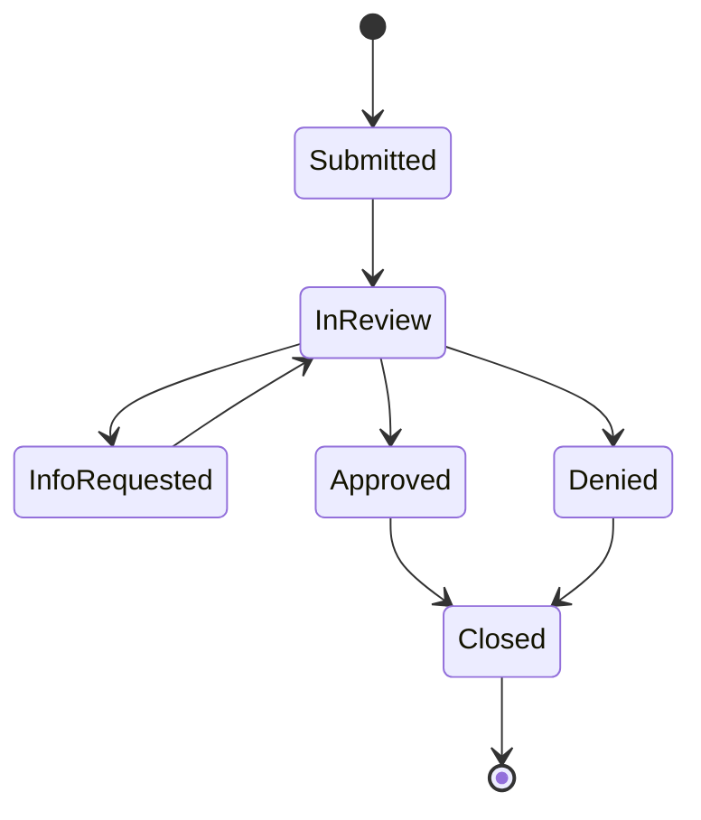

# OneCover Platform

An employee benefits app modeled on group disability and leave workflows, rebuilt as **microservices**.
Members enroll in coverage and file disability leave claims. Admins manage plans, work the claims queue,
and record benefit disbursements.

This is the microservices version of the original OneCover monolith (a layered ASP.NET Core API + Angular app).
Built as a portfolio project in a .NET full-stack training program.

> **Status:** in progress. See [`docs/MICROSERVICES_PLAN.md`](docs/MICROSERVICES_PLAN.md) for the plan and checklist.

## Architecture

```
Angular (web)
     │  one address
  API Gateway (YARP)  ── routes by URL path, rejects bad JWTs
     ├── Identity        users, login/register, JWT, profile       → IdentityDb
     ├── Enrollment      plans, tier rates, eligibility, enrollments → EnrollmentDb
     ├── Claims          claims, workflow, benefit calculator        → ClaimsDb
     └── Disbursements   benefit payouts for approved claims         → DisbursementsDb

Claims ──(ClaimApproved event)──▶ Disbursements
```

| Service | Port |
|---|---|
| Gateway | 5000 |
| Identity | 5001 |
| Enrollment | 5002 |
| Claims | 5003 |
| Disbursements | 5004 |
| Web | 4200 |

- **Database per service.** No service reads another's tables.
- **Shared code is only `contracts/`** (DTOs and event types). No service references another service.
- **Service-to-service calls** go through interfaces (for example `IEnrollmentClient`) over `/internal/**` endpoints that the gateway never exposes.
- **Auth:** Identity issues the JWT. Every service validates it and takes the user id from the token, never the URL or body.
- **Gateway:** external clients call the YARP gateway on port 5000. Internal `/internal/**` calls stay private and are not routed through it.

## What's different from the monolith

- **Disbursements only.** Health-insurance premiums are payroll-deducted, so the system stores no premium payments. Members see an estimated per-paycheck deduction instead.
- **Coverage tiers** priced per plan: Employee only, Employee + spouse, Employee + children, Family. The rate is snapshotted on the enrollment, so later rate changes don't alter what a member pays.
- **Events instead of one transaction.** Approving a claim publishes `ClaimApproved`, and Disbursements creates a pending payout.

## Repo layout

```
contracts/OneCover.Contracts      shared DTOs and events
services/identity/                Identity service
services/enrollment/              Enrollment service
services/claims/                  Claims service
services/disbursements/           Disbursements service
gateway/                          YARP gateway
web/                              Angular app
docs/                             plan, endpoint table, architecture notes
```

## Business rules (carried over from the monolith)

**Disability benefit (STD/LTD)**
- Weekly benefit = annual salary ÷ 52 × the plan's benefit percent, capped at the plan's weekly maximum.
  Example: $78,000 ÷ 52 × 60% = **$900/week** (under a $1,500 STD cap).
- Total benefit = (weekly ÷ 7) × payable days. The first *elimination period* days of a leave aren't paid (7 for STD, 90 for LTD).
- Amounts are calculated **only on the server**, once, when the claim is filed. A claim keeps the terms it was filed under even if the plan changes later.

**Claims**
- Claims are disability leaves, so they can only be filed against **active STD or LTD** coverage.
- The leave can't end before it starts or begin before coverage did, and one claim can't cover more than a year.

**FMLA eligibility:** at least 12 months since the hire date **and** at least 1,250 estimated hours in the last 12 months
(full-time = 40 hours a week, part-time = 20).

**Claim workflow.** Every move writes a history row.



**Security**
- Members only see their own data. Someone else's record returns 404, so the API never confirms it exists.
- Only the last 4 digits of the SSN are stored.
- The UI hides what a role can't do, but every service enforces its own rules.

## Tech stack

| Layer | Technology |
|---|---|
| Services | ASP.NET Core Web API (.NET 10), controllers → services → repositories |
| Gateway | YARP reverse proxy |
| Data | EF Core 10 (code-first migrations), SQL Server, one database per service |
| Auth | JWT bearer tokens, role-based authorization (Member / Admin), hashed passwords |
| Front end | Angular, Angular Material, reactive forms |
| Testing | xUnit, Vitest, Postman collection |
| Run | Docker Compose |

## Running locally

Identity and Enrollment are implemented. The other services, gateway, Angular app, and
Docker Compose integration are still in progress. For local Identity/Enrollment development,
you need the .NET 10 SDK and a SQL Server instance. The example below runs SQL Server in Docker
and keeps connection strings and signing keys in each service's .NET user-secrets store.

### 1. Start SQL Server

In PowerShell, set a strong local password when prompted and start SQL Server:

```powershell
$sqlPassword = [System.Net.NetworkCredential]::new("", (Read-Host "Local SQL Server SA password" -AsSecureString)).Password
docker run --name onecover-sql -e ACCEPT_EULA=Y -e MSSQL_SA_PASSWORD="$sqlPassword" -p 1433:1433 -d mcr.microsoft.com/mssql/server:2022-latest
```

If `onecover-sql` already exists, start it with `docker start onecover-sql`.

### 2. Configure local secrets

Run these commands from `OneCover-platform`. PowerShell variables do not carry over to a
new terminal, so enter the **same SQL Server SA password** used when creating the container.
Identity, Enrollment, Disbursements, and the gateway must use the same JWT issuer, audience,
and key so the gateway and services accept tokens issued by Identity. The internal API key
protects `/internal/**` endpoints; it is not the JWT key.

```powershell
$sqlPassword = [System.Net.NetworkCredential]::new("", (Read-Host "Enter the same SQL Server SA password" -AsSecureString)).Password
if ([string]::IsNullOrWhiteSpace($sqlPassword)) {
    throw "SQL Server SA password cannot be empty."
}

$rng = [System.Security.Cryptography.RandomNumberGenerator]::Create()
$randomBytes = [byte[]]::new(48)
$rng.GetBytes($randomBytes)
$jwtKey = [Convert]::ToBase64String($randomBytes)
$randomBytes = [byte[]]::new(32)
$rng.GetBytes($randomBytes)
$internalApiKey = [Convert]::ToBase64String($randomBytes)

$identityProject = ".\services\identity\OneCover.Identity.Api\OneCover.Identity.Api.csproj"
$enrollmentProject = ".\services\enrollment\OneCover.Enrollment.Api\OneCover.Enrollment.Api.csproj"
$disbursementsProject = ".\services\disbursements\OneCover.Disbursements.Api\OneCover.Disbursements.Api.csproj"
$gatewayProject = ".\gateway\OneCover.Gateway\OneCover.Gateway.csproj"
$connectionBuilder = [System.Data.Common.DbConnectionStringBuilder]::new()
$connectionBuilder["Server"] = "localhost,1433"
$connectionBuilder["User ID"] = "sa"
$connectionBuilder["Password"] = $sqlPassword
$connectionBuilder["TrustServerCertificate"] = "True"
if (-not $connectionBuilder.ContainsKey("Password")) {
    throw "SQL Server password was not added to the connection string."
}
$connectionBuilder["Database"] = "OneCoverIdentityDb"
$identityConnection = $connectionBuilder.ConnectionString
$connectionBuilder["Database"] = "OneCoverEnrollmentDb"
$enrollmentConnection = $connectionBuilder.ConnectionString
$connectionBuilder["Database"] = "DisbursementsDb"
$disbursementsConnection = $connectionBuilder.ConnectionString

dotnet user-secrets set "ConnectionStrings:IdentityDb" "$identityConnection" --project $identityProject
dotnet user-secrets set "ConnectionStrings:EnrollmentDb" "$enrollmentConnection" --project $enrollmentProject
dotnet user-secrets set "ConnectionStrings:DisbursementsDb" "$disbursementsConnection" --project $disbursementsProject
foreach ($project in @($identityProject, $enrollmentProject, $disbursementsProject, $gatewayProject)) {
    dotnet user-secrets set "Jwt:Issuer" "OneCover" --project $project
    dotnet user-secrets set "Jwt:Audience" "OneCoverClients" --project $project
    dotnet user-secrets set "Jwt:Key" "$jwtKey" --project $project
}
foreach ($project in @($identityProject, $enrollmentProject)) {
    dotnet user-secrets set "InternalApiKey" "$internalApiKey" --project $project
}

$adminPassword = [System.Net.NetworkCredential]::new("", (Read-Host "Development admin password" -AsSecureString)).Password
dotnet user-secrets set "DemoAdmin:Email" "admin@onecover.local" --project $identityProject
dotnet user-secrets set "DemoAdmin:Password" "$adminPassword" --project $identityProject
```

The development admin is created only when both `DemoAdmin:Email` and `DemoAdmin:Password`
are configured. New public registrations always receive the `Member` role.

### 3. Build and run

```powershell
dotnet restore .\OneCover.slnx
dotnet build .\OneCover.slnx
dotnet run --project .\services\identity\OneCover.Identity.Api\OneCover.Identity.Api.csproj --launch-profile http
```

In a second terminal:

```powershell
cd D:\Revature\OneCoverMicro\OneCover-platform
dotnet run --project .\services\enrollment\OneCover.Enrollment.Api\OneCover.Enrollment.Api.csproj --launch-profile http
```

In another terminal, start the gateway:

```powershell
cd D:\Revature\OneCoverMicro\OneCover-platform
dotnet run --project .\gateway\OneCover.Gateway\OneCover.Gateway.csproj --launch-profile http
```

Configure the gateway with the same `Jwt:Issuer`, `Jwt:Audience`, and `Jwt:Key` as Identity and
the other JWT-validating services. The gateway defaults to local service URLs on ports 5001–5004;
override destinations with `ReverseProxy__Clusters__<cluster>__Destinations__<destination>__Address`
when deploying. Client applications should use `http://localhost:5000` for public API calls.
Identity login/registration and `GET /api/plans` are anonymous; other routes require a valid
JWT at the gateway and are still authorized by their owning service.

In Development, each service applies its EF Core migrations at startup. Browse the OpenAPI
documents at `http://localhost:5001/openapi/v1.json` and
`http://localhost:5002/openapi/v1.json`. For interactive API testing, open Scalar at
`http://localhost:5001/scalar` (Identity), `http://localhost:5002/scalar` (Enrollment), or
`http://localhost:5175/scalar` (Disbursements when run with its `http` launch profile; Compose
uses port 5004). In Disbursements Scalar, call `GET /dev/token` with `userId` and `role`
(`Member` or `Admin`), then paste the returned token into **Authorize** to test the protected
member and admin endpoints. The member ID should match a disbursement's `MemberId`. The
development-token endpoint and interactive API pages are Development-only.
The API request examples are in the services' `.http` files. Stop either service with
`Ctrl+C`; stop SQL Server with `docker stop onecover-sql`.

The current estimate uses monthly plan rates annualized and divided by 26 pay periods.
Non-disability plans are seeded with sample rates for all four coverage tiers; STD/LTD are
EmployeeOnly. Replace the sample rates with approved business rates before using real data.

## Reference

The original monolith this was derived from is kept as read-only reference, in a sibling folder `../OneCover`.

## Team

Two developers split by service. Ownership and workflow are in [`CLAUDE.md`](CLAUDE.md) and the plan.
