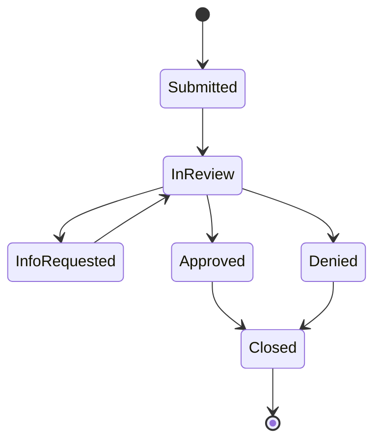

# OneCover Platform

An employee benefits app modeled on group disability and leave workflows, rebuilt as **microservices**.
Members enroll in coverage and file disability leave claims. Admins manage plans, work the claims queue,
and record benefit disbursements.

This is the microservices version of the original OneCover monolith (a layered ASP.NET Core API + Angular app).
Built as a portfolio project in a .NET full-stack training program.

> **Status:** API services, Docker Compose, and the Angular member/admin UI are implemented; full-stack end-to-end verification remains.
> See [`docs/MICROSERVICES_PLAN.md`](docs/MICROSERVICES_PLAN.md) for the plan and checklist.

## Architecture

```
Angular (web)
     │  one address
  API Gateway (YARP)  ── routes by URL path, rejects bad JWTs
     ├── Identity        users, login/register, JWT, profile       → IdentityDb
     ├── Enrollment      plans, tier rates, eligibility, enrollments → EnrollmentDb
     ├── Claims          claims, workflow, benefit calculator        → ClaimsDb
     └── Disbursements   benefit payouts for approved claims         → DisbursementsDb

Claims ──(ClaimApproved event)──▶ Disbursements
```

| Service | Host port |
|---|---|
| Gateway | 5000 |
| Web | 4200 |

- **Database per service.** No service reads another's tables.
- **Private services.** Docker Compose does not publish SQL Server or service API ports to the host; APIs are reachable only on the Compose network.
- **Shared code is only `contracts/`** (DTOs and event types). No service references another service.
- **Service-to-service calls** go through interfaces (for example `IEnrollmentClient`) over `/internal/**` endpoints that the gateway never exposes.
- **Auth:** Identity issues the JWT. Every service validates it and takes the user id from the token, never the URL or body.
- **Gateway:** external clients call the YARP gateway on port 5000. Internal `/internal/**` calls stay private and are not routed through it.

## What's different from the monolith

- **Disbursements only.** Health-insurance premiums are payroll-deducted, so the system stores no premium payments. Members see an estimated per-paycheck deduction instead.
- **Coverage tiers** priced per plan: Employee only, Employee + spouse, Employee + children, Family. The rate is snapshotted on the enrollment, so later rate changes don't alter what a member pays.
- **Events instead of one transaction.** Approving a claim publishes `ClaimApproved`, and Disbursements creates a pending payout.

## Repo layout

```
contracts/OneCover.Contracts      shared DTOs and events
services/identity/                Identity service
services/enrollment/              Enrollment service
services/claims/                  Claims service
services/disbursements/           Disbursements service
gateway/                          YARP gateway
web/                              Angular app
docs/                             plan, endpoint table, architecture notes
```

## Business rules (carried over from the monolith)

**Disability benefit (STD/LTD)**
- Weekly benefit = annual salary ÷ 52 × the plan's benefit percent, capped at the plan's weekly maximum.
  Example: $78,000 ÷ 52 × 60% = **$900/week** (under a $1,500 STD cap).
- Total benefit = (weekly ÷ 7) × payable days. The first *elimination period* days of a leave aren't paid (7 for STD, 90 for LTD).
- Amounts are calculated **only on the server**, once, when the claim is filed. A claim keeps the terms it was filed under even if the plan changes later.

**Claims**
- Claims are disability leaves, so they can only be filed against **active STD or LTD** coverage.
- The leave can't end before it starts or begin before coverage did, and one claim can't cover more than a year.

**FMLA eligibility:** at least 12 months since the hire date **and** at least 1,250 estimated hours in the last 12 months
(full-time = 40 hours a week, part-time = 20).

**Claim workflow.** Every move writes a history row.



**Security**
- Members only see their own data. Someone else's record returns 404, so the API never confirms it exists.
- Only the last 4 digits of the SSN are stored.
- The UI hides what a role can't do, but every service enforces its own rules.

## Tech stack

| Layer | Technology |
|---|---|
| Services | ASP.NET Core Web API (.NET 10), controllers → services → repositories |
| Gateway | YARP reverse proxy |
| Data | EF Core 10 (code-first migrations), SQL Server, one database per service |
| Auth | JWT bearer tokens, role-based authorization (Member / Admin), hashed passwords |
| Front end | Angular, Angular Material, reactive forms |
| Testing | xUnit, Vitest, Postman collection |
| Run | Docker Compose |

## Running locally

### Prerequisites

- Git
- Docker Desktop, running with the Linux container engine
- Node.js 24 LTS (includes npm) for the Angular frontend

The .NET 10 SDK is only needed for local builds and tests; Docker builds the backend services.

### Get the `DeveloperABranch` branch

For a fresh checkout:

```powershell
git clone --branch DeveloperABranch https://github.com/GitUpahGitOnUp/OneCover-platform.git
Set-Location .\OneCover-platform
```

To update an existing checkout:

```powershell
Set-Location .\OneCover-platform
git fetch origin
git switch DeveloperABranch
git pull origin DeveloperABranch
```

### Configure local secrets

Create your local `.env` from the example. It is ignored by Git; do not commit it or share its
contents.

```powershell
Copy-Item .env.example .env
notepad .env
```

Replace the blank `MSSQL_SA_PASSWORD`, `JWT_KEY`, and `INTERNAL_API_KEY` values with private,
random values. `JWT_KEY` must be at least 32 bytes. `INTERNAL_API_KEY` must be the same value for
Claims and Disbursements; Compose shares it automatically. Keep
`DEMO_ADMIN_SEED_ON_STARTUP=false` unless you specifically want to seed an admin account.

You can generate values locally in PowerShell without installing extra tools. Run this snippet,
then copy each labeled value into the matching `.env` entry. It generates a distinct SQL password
and signing/internal keys each time:

```powershell
function New-RandomBytes([int]$Count) {
    $bytes = New-Object byte[] $Count
    $generator = [System.Security.Cryptography.RandomNumberGenerator]::Create()
    try { $generator.GetBytes($bytes) } finally { $generator.Dispose() }
    return ,$bytes
}

$sqlPassword = [Convert]::ToBase64String((New-RandomBytes 32)) + '!aA9'
$jwtKey = [Convert]::ToBase64String((New-RandomBytes 32)).TrimEnd('=').Replace('+', '-').Replace('/', '_')
$internalApiKey = [Convert]::ToBase64String((New-RandomBytes 32)).TrimEnd('=').Replace('+', '-').Replace('/', '_')
Write-Output "MSSQL_SA_PASSWORD=$sqlPassword"
Write-Output "JWT_KEY=$jwtKey"
Write-Output "INTERNAL_API_KEY=$internalApiKey"
```

Save `.env` before starting Docker. For a brand-new local database, the generated SQL password is
used to initialize SQL Server. If this checkout already has a persistent SQL volume, changing
`MSSQL_SA_PASSWORD` alone will not change the existing SQL login; keep the password that created
that volume or rotate the SQL login deliberately. Do not delete the volume to resolve a password
mismatch if you need to keep its data.

### Start the backend

Make sure Docker Desktop is running, then run from the repository root:

```powershell
docker compose up --build -d
docker compose ps
```

The first build may take several minutes. Wait until SQL Server is healthy and the API and gateway
containers are running. To inspect startup output:

```powershell
docker compose logs -f gateway
```

Press Ctrl+C to stop following logs; this does not stop the containers. The gateway is available at
`http://localhost:5000`. Compose starts SQL Server and all four APIs, applying each service's own
migrations to its own database. Containers run in Production mode; the development-only
Disbursements token endpoint and interactive API pages are not enabled. Only the Gateway is
available from the host. Service-to-service calls use the shared internal key on the private
Compose network; `/internal/**` is not publicly routed.

### Start the frontend

In a second PowerShell terminal, from the repository root:

```powershell
Set-Location .\web
npm ci
npm start
```

Open `http://localhost:4200` or `http://127.0.0.1:4200`, create a member account, browse plans,
and enroll in coverage. Once enrolled in STD or LTD, use Claims to file and track a disability
claim. Admin accounts can review the claims queue, move claims through their allowed workflow,
and resend an unconfirmed payout request. Keep both terminals running while using the app.

Public registration always creates a Member account. To create a local admin account, set these
values in `.env` before restarting Identity:

```dotenv
DEMO_ADMIN_SEED_ON_STARTUP=true
DEMO_ADMIN_EMAIL=admin@onecover.local
DEMO_ADMIN_PASSWORD=<a-unique-private-password-you-choose>
```

There is deliberately no built-in admin password. The login email is
`admin@onecover.local`; the password is the private value you set in `.env`. Restart Identity to
seed the account:

```powershell
docker compose up -d identity
docker compose logs identity
```

The seeder creates the account only if that email does not already exist. If it was seeded earlier,
changing `.env` will not reset its password; use the existing password or configure a different
admin email. Keep the password private and do not use production credentials for a local demo.
After signing in, admins land on the Admin dashboard and can open the claims queue.

Stop the frontend with Ctrl+C. Stop the backend containers with `docker compose down` from the
repository root. The named SQL volume persists local data.

Build and run all unit and integration tests from the repository root:

```powershell
dotnet test .\OneCover.slnx
```

In Development, the API services apply their EF Core migrations at startup and expose OpenAPI.
Compose runs services in Production mode and does not publish their ports. The API request
examples are in the services' `.http` files. Claims endpoints and request shapes are documented
in [`docs/HANDOFF_TO_DEV_A.md`](docs/HANDOFF_TO_DEV_A.md#64-claims-public-api-what-the-gateway-and-angular-will-call).

The Angular app lives in `web/` and sends browser API requests only to the YARP gateway. Its
gateway URL is runtime-configurable in `web/public/config.json`; change `apiBaseUrl` for a
different environment rather than adding individual service URLs to the frontend. The frontend
includes member registration/sign-in, profile and coverage pages, claim filing/history, an
admin-only claims overview and workflow, and a persisted light/dark glass theme toggle. When
hosting the frontend elsewhere, set the gateway's `Cors:AllowedOrigins` configuration to the exact
frontend origin(s).

The current estimate uses monthly plan rates annualized and divided by 26 pay periods.
Non-disability plans are seeded with sample rates for all four coverage tiers; STD/LTD are
EmployeeOnly. Replace the sample rates with approved business rates before using real data.

## Reference

The original monolith this was derived from is kept as read-only reference, in a sibling folder `../OneCover`.

## Team

Two developers split by service. Ownership and workflow are in [`CLAUDE.md`](CLAUDE.md) and the plan.
